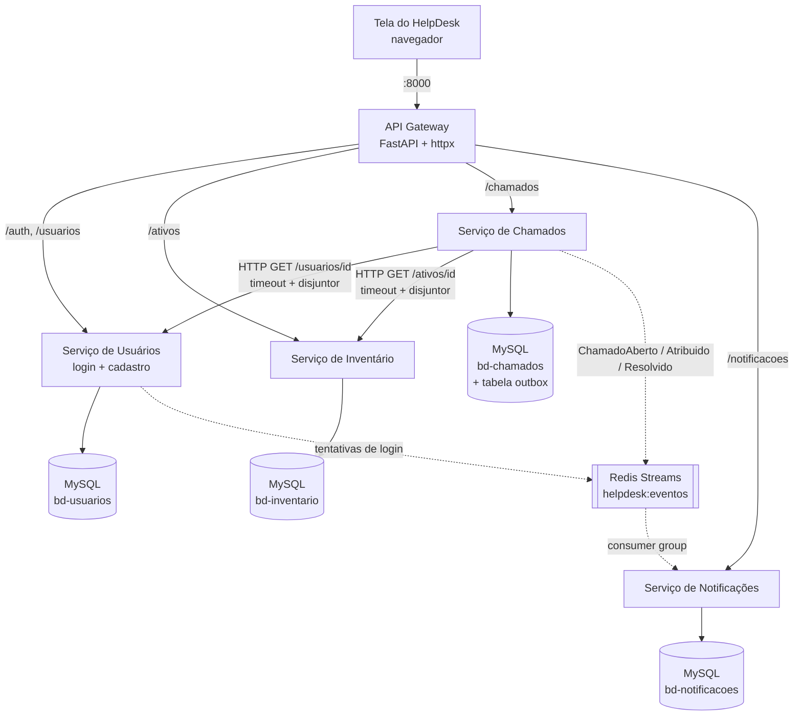

# HelpDesk TI · versão em microsserviços

> 🎥 **Vídeo de demonstração:** _(link do vídeo aqui)_

Trabalho individual de **Arquitetura de Software** (Prof. Filipe Cavalcante).
Peguei o HelpDesk TI, que era um monólito (uma aplicação, um banco), e separei em microsserviços,
sem perder nenhuma funcionalidade. O enunciado está em [DESAFIO.md](DESAFIO.md).

Aluno: **Kaike**

## Arquitetura nova



| Serviço | Pasta | O que faz | Banco |
|---|---|---|---|
| **Gateway** | [gateway/](gateway) | Único ponto de entrada (porta 8000). Serve a tela e repassa cada rota pro serviço certo. `/saude` mostra quem está no ar. | — |
| **Usuários** | [servicos/usuarios/](servicos/usuarios) | Login (emite o token JWT) e cadastro de usuários | `bd-usuarios` |
| **Inventário** | [servicos/inventario/](servicos/inventario) | Equipamentos de TI | `bd-inventario` |
| **Chamados** | [servicos/chamados/](servicos/chamados) | Abrir, atribuir, mudar status, comentar, painel. Chama Usuários e Inventário por HTTP. | `bd-chamados` |
| **Notificações** (bônus) | [servicos/notificacoes/](servicos/notificacoes) | Consome os eventos do Redis e guarda os avisos | `bd-notificacoes` |
| comum | [comum/](comum) | Código de infraestrutura que todos usam: conferir token, cabeçalhos de segurança, erros, conexão com banco | — |

### Como eles conversam

- **Tela → Gateway:** a tela continua chamando `/chamados`, `/ativos` etc. no mesmo endereço. Quem decide pra onde vai é o gateway (tabela `ROTAS` em [gateway/app/main.py](gateway/app/main.py)).
- **Chamados → Usuários / Inventário (síncrono, HTTP):** antes de atribuir, o Chamados faz `GET /usuarios/{id}` pra ver se é técnico. Antes de abrir com equipamento, faz `GET /ativos/{id}`. O token do usuário vai junto. Código em [servicos/chamados/app/clientes.py](servicos/chamados/app/clientes.py).
- **Chamados → Notificações (assíncrono, evento):** o Chamados não chama o Notificações. Ele publica o evento no Redis e quem quiser escuta.

## Como rodar

```bash
docker compose up --build
```

Pronto, não precisa criar `.env` (veja "segredos" nas decisões). Depois abra **http://localhost:8000**.

Na primeira vez demora um pouco porque os 4 MySQL precisam inicializar (uns 30 a 60 segundos).
Pra ver se está tudo de pé:

```bash
docker compose ps
curl http://localhost:8000/saude
```

**Não tem Docker na máquina?** Dá pra rodar no GitHub Codespaces: no repositório, clique em
**Code → Codespaces → Create codespace**, espere abrir e rode o mesmo `docker compose up --build`
no terminal. A porta 8000 aparece na aba **Portas**.

### Contas de acesso

Todas com a senha **`Helpdesk2026`** (dá pra trocar com `SENHA_EXEMPLO` no `.env`).

| E-mail | Perfil |
|---|---|
| `admin@empresa.com` | Administrador |
| `carla@empresa.com` | Técnica (use essa pro fluxo completo) |
| `diego@empresa.com` | Técnico |
| `ana@empresa.com` | Solicitante (use essa pra testar permissão) |
| `bruno@empresa.com` | Solicitante |

### Comandos úteis pra testar

```bash
# sem token -> 401
curl -i http://localhost:8000/chamados

# derrubar o inventário e ver o resto funcionando
docker compose stop inventario
docker compose start inventario

# ver os eventos chegando no serviço de notificações
docker compose logs -f notificacoes chamados

# ver os volumes (um banco pra cada serviço)
docker volume ls | grep helpdesk
```

## Decisões que eu tomei

**1. Um MySQL por serviço, em redes separadas.**
Cada banco fica numa rede Docker `internal` que só tem ele e o seu serviço (`rede-usuarios`, `rede-chamados`...).
Então além de "não pode" ler o banco do outro, o Chamados nem *consegue* chegar no `bd-usuarios`.
As chaves estrangeiras `chamados.solicitante_id → usuarios.id` e `chamados.ativo_id → ativos.id` saíram;
agora é só um número, e quem garante que existe é a chamada HTTP antes de salvar.

**2. Timeout + "disjuntor" (circuit breaker) nas chamadas HTTP.**
Timeout de 3 s (2 s pra conectar). Se o Inventário falhar 3 vezes seguidas, o disjuntor abre e por 15 s
o Chamados já responde **503** direto, sem esperar timeout de novo. O estado dos disjuntores aparece no `/saude`.

**3. Eventos com "outbox" + Redis Streams (bônus).**
O evento é gravado numa tabela `eventos_pendentes` **na mesma transação** do chamado. Uma thread manda os
pendentes pro Redis a cada segundo. Por quê: se eu publicasse direto no Redis e ele estivesse fora, ou o
chamado não abria, ou o evento se perdia. Assim o chamado sempre abre e o evento sai quando der.
O Notificações lê com *consumer group*: se ele cair, o Redis guarda o que ele não leu e entrega quando voltar.
Cada aviso guarda o `evento_id` (único), então se o mesmo evento chegar duas vezes não duplica.

**4. Token com perfil e nome, conferido em todo serviço.**
Só o Usuários cria o token. Todo serviço confere (assinatura, validade, emissor). Como o perfil vai no
token, os serviços aplicam as permissões sem perguntar pro Usuários a cada requisição.
O lado ruim: se um usuário for desativado, o token dele vale até vencer (60 min).

**5. Segredos gerados no primeiro start.**
O professor tem que conseguir rodar só com `docker compose up --build`. Mas eu não queria colocar
`JWT_SEGREDO` nem senha de banco no código. Então tem um contêiner `segredos` que roda uma vez, gera tudo
num volume ([infra/gerar_segredos.py](infra/gerar_segredos.py)) e os serviços leem de lá
(o MySQL lê com `MYSQL_PASSWORD_FILE`). Se tiver `JWT_SEGREDO` no `.env`, ele tem prioridade.

**6. Limite de tentativas de login no Redis.**
No monólito era um dicionário em memória. Com microsserviços eu posso ter 2 cópias do Usuários e
cada uma contaria separado. Foi pro Redis (e se o Redis cair, volta pra memória).

**7. Pasta `comum/`.**
Código de infraestrutura (conferir token, cabeçalhos de segurança, erros) ficou numa pasta compartilhada
que cada Dockerfile copia no build. Regra de negócio **não** entra aí. Assim cada serviço continua sendo
publicado sozinho, mas eu não copio o mesmo código de segurança 4 vezes.

**8. A tela.**
Mudou quase nada: a tela ganhou um quadrinho **Serviços** (lê o `/saude` do gateway a cada 5 s), e se
o Inventário cair ela mantém a lista de equipamentos que já tinha, pra dar pra ver o erro 503 ao abrir chamado.

## O que ficou melhor e o que ficou mais difícil

| Melhor | Mais difícil |
|---|---|
| Cada serviço sobe, cai e é publicado sozinho | Tem a rede no meio: pode ter timeout, serviço fora, mensagem repetida |
| Se o Inventário cair, só abrir chamado com equipamento para | Não tem mais FK entre serviços, a consistência é na aplicação |
| Notificações fora não impede abrir chamado | Mais coisa pra subir (11 contêineres) e mais memória |
| Cada time cuida do seu serviço e do seu banco | Dados de exemplo precisam combinar ids entre serviços |
| Dá pra escalar só o serviço que precisa | Debug fica espalhado em vários logs |

## Rotas (todas pelo gateway, porta 8000)

| Método | Rota | Serviço | Quem pode |
|---|---|---|---|
| POST | `/auth/login` | Usuários | Todos |
| GET | `/auth/eu` | Usuários | Logado |
| POST / GET | `/usuarios` | Usuários | Admin / logado |
| GET | `/usuarios/{id}` | Usuários | Logado (usada pelo Chamados) |
| POST / GET | `/ativos` | Inventário | Técnico e admin / logado |
| GET | `/ativos/{id}` | Inventário | Logado (usada pelo Chamados) |
| POST / GET | `/chamados` | Chamados | Logado (solicitante vê só os seus) |
| GET | `/chamados/painel` | Chamados | Logado |
| PATCH | `/chamados/{id}/atribuir` | Chamados | Técnico e admin |
| PATCH | `/chamados/{id}/status` | Chamados | Técnico e admin (solicitante: fechar/reabrir) |
| POST | `/chamados/{id}/comentarios` | Chamados | Envolvidos |
| GET | `/notificacoes` | Notificações | Logado (só as suas) |
| GET | `/saude` | Gateway | Todos (mostra quem está no ar) |

As regras continuam iguais ao monólito: SLA (crítica 4 h, alta 8 h, média 24 h, baixa 72 h) e as
transições de status (`aberto → em_atendimento → resolvido → fechado`, com reabrir).

## Testes

Cada serviço tem os seus testes e roda separado (também no GitHub Actions, um job por serviço):

```bash
cd servicos/chamados
pip install -r requirements.txt pytest httpx
pytest -q
```

| Serviço | Testes | Destaques |
|---|---|---|
| usuarios | 17 | login, bloqueio por tentativas, token adulterado / outro segredo / `alg: none` / vencido, hash scrypt |
| inventario | 7 | 401 sem token, permissão de cadastro |
| chamados | 19 | regras do monólito, token repassado, **Inventário/Usuários fora → 503**, disjuntor |
| notificacoes | 4 | evento vira aviso, evento repetido não duplica, cada um vê só os seus |
| gateway | 12 | cada rota vai pro serviço certo, serviço fora → 503, não repassa cookie, cabeçalhos de segurança |

Nos testes do Chamados os outros serviços são simulados com `httpx.MockTransport`, então dá pra
testar a queda deles sem subir nada.

Segurança: veja [SECURITY.md](SECURITY.md).

## Estrutura

```
comum/                     # infraestrutura compartilhada (token, segurança HTTP, erros, banco)
gateway/                   # API Gateway + tela (web/)
servicos/
├── usuarios/              # cada um com app/, tests/, Dockerfile e requirements.txt próprios
├── inventario/
├── chamados/              # clientes.py (HTTP), eventos.py (outbox -> Redis)
└── notificacoes/          # consumidor.py (Redis -> banco)
infra/gerar_segredos.py    # gera JWT e senhas dos bancos no 1º start
docker-compose.yml
```
